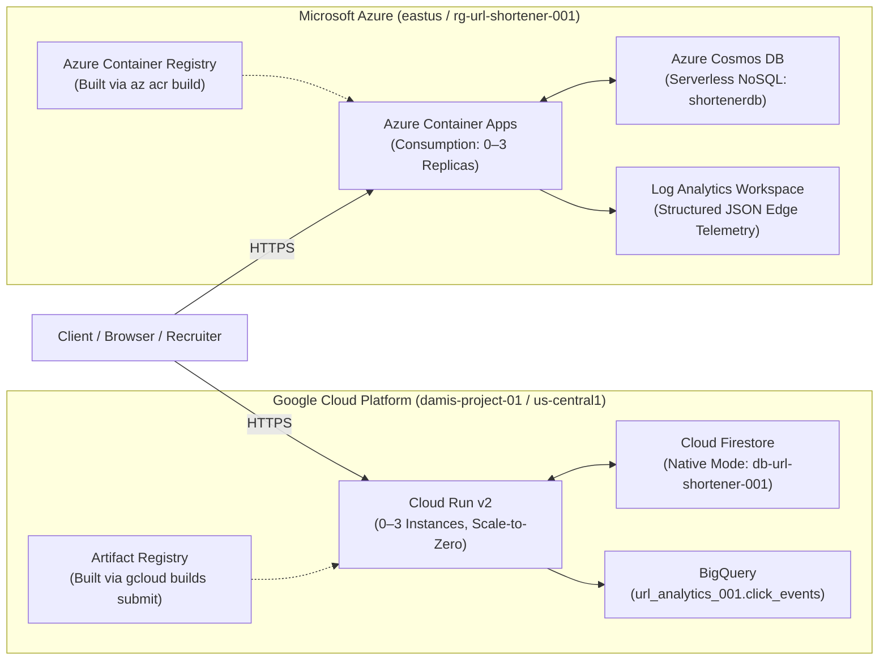

# Project 001: Multi-Cloud Serverless URL Shortener & Edge Analytics

A scale-to-zero, Bitly-style URL shortener and real-time click telemetry service written in **Python (FastAPI)** and deployed symmetrically across **Google Cloud Platform** and **Microsoft Azure** via **Terraform** and **keyless OIDC GitHub Actions**.

---

## Architecture Diagram



---

## GCP vs. Azure Architectural Parity

| Capability | GCP Implementation | Azure Implementation | FinOps Idle Cost |
| :--- | :--- | :--- | :--- |
| **Serverless Compute** | Cloud Run v2 (`min_instance_count = 0`) | Container Apps Consumption (`min_replicas = 0`) | `$0.00` |
| **NoSQL Link Store** | Cloud Firestore Native (`db-url-shortener-001`) | Azure Cosmos DB (`EnableServerless`) | `$0.00` |
| **Edge Click Analytics** | BigQuery (`click_events`) + Cloud Logging | Log Analytics Workspace (`PerGB2018`) | `$0.00` |
| **Remote Container Build** | `gcloud builds submit` -> Artifact Registry | `az acr build` -> Azure Container Registry | Pay-per-build second |
| **Zero-Trust Identity** | Dedicated GCP Service Account (`sa-url-shortener-001`) | User-Assigned Managed Identity (`id-urlshortener001`) | `$0.00` |

---

## Live Spin-Up Runbook (For Technical & Non-Technical Leads)

### 1. Spin Up Live on GitHub Actions
1. Open **[Actions -> Deploy Project Live (GCP & Azure)](https://github.com/dami-akinbi/multicloud-iac-100/actions/workflows/deploy.yml)**.
2. Click **Run workflow** with:
   * `project_name`: `001-multicloud-url-shortener`
   * `cloud_target`: `both` (or `gcp` / `azure` individually)
   * `run_smoke_test`: `true`
3. Open the completed workflow run **Summary** to copy the live public HTTPS URLs (`SERVICE_URL`) for both Cloud Run and Azure Container Apps.

### 2. Interactive Demo Commands
Replace `<SERVICE_URL>` with either the GCP Cloud Run URL or the Azure Container App URL:

```bash
# 1. Check service & cloud backend health
curl -s <SERVICE_URL>/health

# 2. Create a custom short URL
curl -s -X POST <SERVICE_URL>/shorten \
  -H "Content-Type: application/json" \
  -d '{"url": "[https://github.com/dami-akinbi/multicloud-iac-100](https://github.com/dami-akinbi/multicloud-iac-100)", "custom_code": "dami-cloud"}'

# 3. Open <SERVICE_URL>/dami-cloud in any browser (or test HTTP 302 redirect via curl)
curl -I <SERVICE_URL>/dami-cloud

# 4. Inspect real-time click analytics & BigQuery/edge telemetry
curl -s <SERVICE_URL>/stats/dami-cloud
```

### 3. FinOps Teardown (Zero Lingering Cost)
1. Open **[Actions -> Teardown Project Infrastructure (FinOps)](https://github.com/dami-akinbi/multicloud-iac-100/actions/workflows/teardown.yml)**.
2. Click **Run workflow** with `project_name: 001-multicloud-url-shortener`, `cloud_target: both`, and `run_smoke_test: true`.
